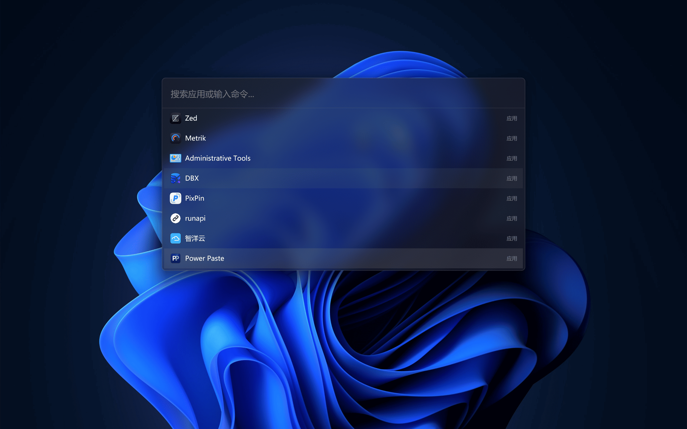

# Steward

<p align="center">
  
</p>

<p align="center">
  <a href="LICENSE"></a>
  
  
  <a href="https://github.com/iFence/steward"></a>
</p>

<p align="center">
  <a href="README_CN.md">中文版</a>
</p>

Steward is a Windows launcher and plugin platform built with Rust, GPUI Fast,
and Native Shell (NSH).

Search installed applications and common Windows Settings pages from the same
launcher, then open a matching setting directly instead of navigating through
the Settings app.

The launcher is an NSH Rust surface and the settings window uses GPUI Kit
components, so neither starts a JavaScript VM. Plugin commands open signed TSX
applications in full NSH windows with a 64 MiB VM, time/node quotas, and
least-privilege capabilities.

<p align="center">
  
</p>

## Repository structure

```text
steward/
├── Cargo.toml
├── crates/
│   ├── app/                 GPUI Fast shell, tray, hotkeys, plugin windows
│   ├── core-engine/         application search and matching
│   ├── plugin-host/         signed package verification and route catalog
│   ├── plugin-registry/     plugin.json v2 metadata cache
│   ├── storage/             SQLite and settings
│   └── ui-components/       NSH Rust launcher components
├── packages/
│   ├── extension-api/       typed Steward host calls for TSX plugins
│   └── plugins/             Calendar, Clipboard History, UI Showcase
├── assets/nsh/              release trust roots
├── docs/                    architecture, migration, API, release records
└── scripts/                 plugin packaging, MSI, and benchmarks
```

## Getting started

Prerequisites:

- Rust 1.97.1 with the MSVC target
- Node.js 20 or newer
- pnpm 11
- The pinned NSH CLI for plugin development

Install the reviewed NSH CLI revision:

```powershell
cargo install --locked --git https://github.com/longbridge/nsh `
  --rev 5359c07ff7b5728e67957c24322373309c90666b nsh-cli
```

Build and run:

```powershell
pnpm install
pnpm typecheck
pnpm build
cargo run -p steward-app
```

The app starts silently in the system tray. Summon it with `Ctrl+Alt+Space`.
Set `STEWARD_SHOW_ON_START=1` for development if the launcher should be visible
immediately.

## Installing existing plugins

Download the required `steward-plugin-<name>-<version>.zip` asset from
[GitHub Releases](https://github.com/iFence/steward/releases). Each archive
contains the plugin directory, `plugin.json`, and the signed `plugin.nshpkg`:

```text
calendar/
  plugin.json
  plugin.nshpkg
```

Extract the archive into `%APPDATA%\Steward\plugins`:

```powershell
$plugins = Join-Path $env:APPDATA "Steward\plugins"
New-Item -ItemType Directory -Force -Path $plugins | Out-Null
Expand-Archive -LiteralPath .\steward-plugin-calendar-0.2.0.zip `
  -DestinationPath $plugins -Force
```

The resulting layout should be:

```text
%APPDATA%\Steward\plugins\
  calendar\
    plugin.json
    plugin.nshpkg
```

Steward scans this directory at startup and every 30 seconds while running.
Open the launcher and type one of the plugin commands:

- Calendar: `calendar`
- Clipboard History: `clipboard-history`
- UI Showcase: `uishowcase`

There is currently no in-app plugin marketplace or installer. Installation is
the extraction above; do not copy only `plugin.nshpkg` or flatten the plugin
files into the `plugins` root. Only a signed package whose manifest and package
ID/version match can be opened.

## Plugin development

Each official plugin has:

```text
App.tsx          NSH TSX application
nsh.json         NSH package metadata
plugin.json      Steward v2 routing metadata
App.test.tsx     headless NSH test
```

Run `nsh check App.tsx`, `nsh test .`, and `nsh build App.tsx --release -o dist`
from a plugin directory. See [docs/nsh-plugin-api.md](docs/nsh-plugin-api.md)
for Steward's host bridge and [docs/plugin-manifest-spec.md](docs/plugin-manifest-spec.md)
for the route manifest.

Release packages are signed with the NSH release key and certificate:

```powershell
$env:STEWARD_NSH_RELEASE_KEY = "<path-or-secret>"
$env:STEWARD_NSH_RELEASE_CERT = "<path-or-secret>"
.\scripts\package-plugins.ps1
```

The resulting zip contains only `plugin.json` and `plugin.nshpkg`. Extract its
top-level plugin directory under `%APPDATA%\Steward\plugins`.

## Releases

Pushing a version tag such as `v0.3.0` starts the Windows build-and-release
workflow. The tag must match `[workspace.package].version` in `Cargo.toml`, and
`Changelog.md` must contain a matching `## vX.Y.Z` section. The workflow builds
the MSI, signs and packages the official plugins, generates SHA-256 checksums,
and publishes the files on the GitHub Release.

Configure `STEWARD_NSH_RELEASE_KEY` and `STEWARD_NSH_RELEASE_CERT` as repository
secrets containing the signing key and certificate file contents:

```powershell
git tag v0.3.0
git push origin v0.3.0
```

## Documentation

- [Architecture](docs/architecture.md)
- [NSH migration plan and status](docs/nsh-migration.md)
- [NSH plugin API](docs/nsh-plugin-api.md)
- [Plugin manifest v2](docs/plugin-manifest-spec.md)
- [Performance benchmarks](docs/benchmarks.md)
- [Roadmap](docs/roadmap.md)
- [Changelog](Changelog.md)

## Milestones

- [x] M0: GPUI launcher shell, tray, and global hotkey
- [x] M1: application launcher MVP
- [x] NSH-0: migration decisions and contracts
- [x] NSH-1: GPUI Fast and NSH embedding
- [x] NSH-2: NSH Rust launcher and GPUI Kit settings
- [x] NSH-3: NSH plugin windows and official plugin migration
- [ ] NSH-4: production keys, release benchmarks, and final acceptance

## License

[MIT](LICENSE). NSH-derived notices are listed in
[THIRD_PARTY_NOTICES.md](THIRD_PARTY_NOTICES.md).
