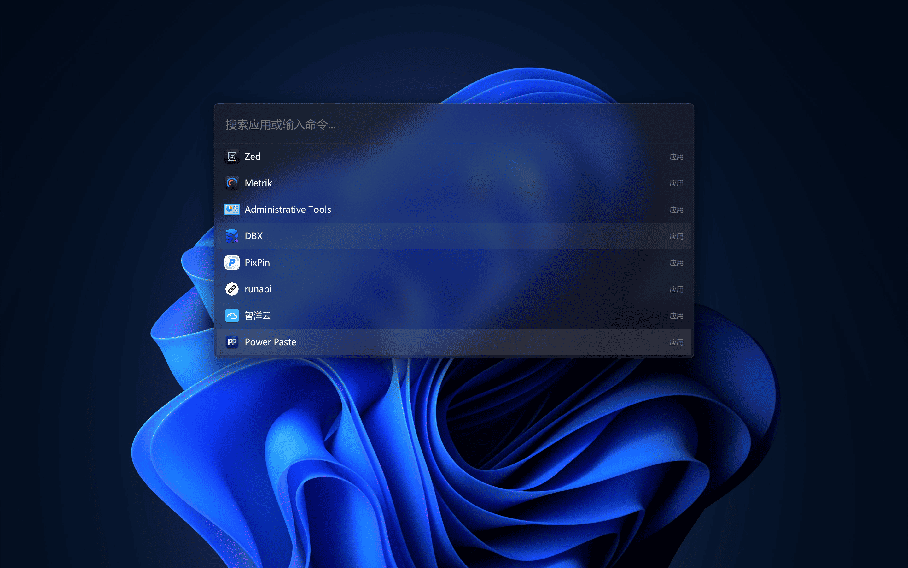

# Steward

<p align="center">
  
</p>

<p align="center">
  <a href="LICENSE"></a>
  
  
  <a href="https://github.com/iFence/steward"></a>
</p>

<p align="center">
  <a href="README.md">English</a>
</p>

Steward 是一个面向 Windows 的启动器与插件平台，使用 Rust、GPUI Fast 和
Native Shell（NSH）构建。

可以在同一个启动器中搜索已安装应用和常用 Windows 设置页面，并直接打开目标
设置，无需逐层进入“设置”应用。

启动器是 NSH Rust 界面，设置页使用 GPUI Kit 组件，两者都不启动 JavaScript
VM。插件命令会在完整 NSH 窗口中打开已签名的 TSX 应用，并为每个窗口配置
64 MiB VM、调用时限、节点上限和最小权限能力。

<p align="center">
  
</p>

## 仓库结构

```text
steward/
├── Cargo.toml
├── crates/
│   ├── app/                 GPUI Fast 外壳、托盘、热键、插件窗口
│   ├── core-engine/         应用搜索与匹配
│   ├── plugin-host/         签名包校验与路由目录
│   ├── plugin-registry/     plugin.json v2 元数据缓存
│   ├── storage/             SQLite 与设置
│   └── ui-components/       NSH Rust 启动器组件
├── packages/
│   ├── extension-api/       TSX 插件使用的 Steward 宿主调用类型
│   └── plugins/             Calendar、Clipboard History、UI Showcase
├── assets/nsh/              Release 信任根
├── docs/                    架构、迁移、API 与发布记录
└── scripts/                 插件打包、MSI 与基准脚本
```

## 快速开始

前置要求：

- Rust 1.97.1 与 MSVC target
- Node.js 20 或更高版本
- pnpm 11
- 开发插件所需的固定版本 NSH CLI

安装经过审查的 NSH CLI 提交：

```powershell
cargo install --locked --git https://github.com/longbridge/nsh `
  --rev 5359c07ff7b5728e67957c24322373309c90666b nsh-cli
```

构建与运行：

```powershell
pnpm install
pnpm typecheck
pnpm build
cargo run -p steward-app
```

应用启动后驻留系统托盘，默认不显示窗口。使用 `Ctrl+Alt+Space` 呼出。开发时可
设置 `STEWARD_SHOW_ON_START=1` 让启动器立即显示。

## 安装现有插件

从 [GitHub Releases](https://github.com/iFence/steward/releases) 下载所需的
`steward-plugin-<name>-<version>.zip`。每个 zip 内包含插件目录、`plugin.json`
和已签名的 `plugin.nshpkg`：

```text
calendar/
  plugin.json
  plugin.nshpkg
```

把 zip 解压到 `%APPDATA%\Steward\plugins`：

```powershell
$plugins = Join-Path $env:APPDATA "Steward\plugins"
New-Item -ItemType Directory -Force -Path $plugins | Out-Null
Expand-Archive -LiteralPath .\steward-plugin-calendar-0.2.0.zip `
  -DestinationPath $plugins -Force
```

安装后的目录结构应为：

```text
%APPDATA%\Steward\plugins\
  calendar\
    plugin.json
    plugin.nshpkg
```

Steward 会在启动时以及运行期间每 30 秒扫描一次该目录。打开启动器并输入对应命令：

- Calendar：`calendar`
- Clipboard History：`clipboard-history`
- UI Showcase：`uishowcase`

目前没有应用内插件市场或安装器，安装就是上述解压操作。不要只复制
`plugin.nshpkg`，也不要把插件文件直接平铺到 `plugins` 根目录。只有 manifest
与包内 ID/版本一致且签名有效的插件才能打开。

## 插件开发

每个官方插件包含：

```text
App.tsx          NSH TSX 应用
nsh.json         NSH 包元数据
plugin.json      Steward v2 路由元数据
App.test.tsx     NSH 无头测试
```

在插件目录运行 `nsh check App.tsx`、`nsh test .` 和
`nsh build App.tsx --release -o dist`。Steward 宿主接口见
[docs/nsh-plugin-api.md](docs/nsh-plugin-api.md)，路由清单见
[docs/plugin-manifest-spec.md](docs/plugin-manifest-spec.md)。

发布包使用 NSH release key/certificate 签名：

```powershell
$env:STEWARD_NSH_RELEASE_KEY = "<path-or-secret>"
$env:STEWARD_NSH_RELEASE_CERT = "<path-or-secret>"
.\scripts\package-plugins.ps1
```

生成的 zip 只包含 `plugin.json` 与 `plugin.nshpkg`。把 zip 顶层插件目录解压到
`%APPDATA%\Steward\plugins` 即可。

## 发布

推送 `v0.3.0` 这类版本 tag 会触发 Windows 构建与发布流水线。tag 必须与
`Cargo.toml` 中 `[workspace.package].version` 一致，且 `Changelog.md` 必须包含对应的
`## vX.Y.Z` 小节。流水线会构建 MSI、签名并打包官方插件、生成 SHA-256 校验和，然后
把产物发布到 GitHub Release。

请在仓库 Secrets 中配置 `STEWARD_NSH_RELEASE_KEY` 和
`STEWARD_NSH_RELEASE_CERT`，值分别为签名私钥与证书的文件内容：

```powershell
git tag v0.3.0
git push origin v0.3.0
```

## 文档

- [架构说明](docs/architecture.md)
- [NSH 迁移计划与状态](docs/nsh-migration.md)
- [NSH 插件 API](docs/nsh-plugin-api.md)
- [插件 manifest v2](docs/plugin-manifest-spec.md)
- [性能基准](docs/benchmarks.md)
- [Roadmap](docs/roadmap.md)
- [更新日志](Changelog-zh-CN.md)

## 里程碑

- [x] M0：GPUI 启动器骨架、托盘与全局热键
- [x] M1：应用启动器 MVP
- [x] NSH-0：迁移决策与公共契约
- [x] NSH-1：GPUI Fast 与 NSH 嵌入
- [x] NSH-2：NSH Rust 启动器与 GPUI Kit 设置页
- [x] NSH-3：NSH 插件窗口与官方插件迁移
- [ ] NSH-4：生产签名密钥、Release 基准与最终验收

## 许可证

[MIT](LICENSE)。NSH 相关声明见
[THIRD_PARTY_NOTICES.md](THIRD_PARTY_NOTICES.md)。
